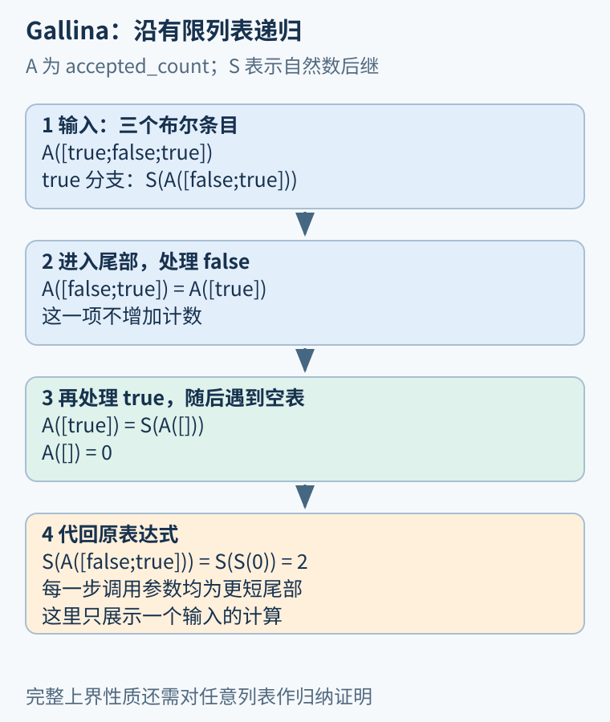
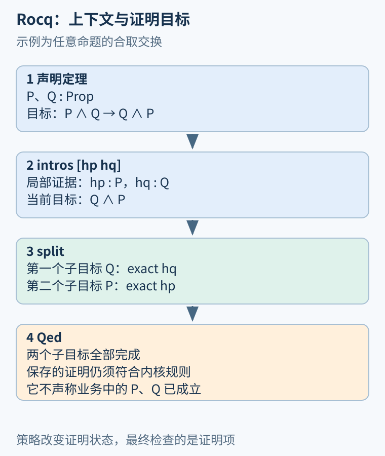

# 第 28 章 Rocq 实作：定义、归纳与内核检查

在阅读 CompCert、VST 或 Software Foundations 时，会遇到很多 `.v` 文件、`Proof` 与 `Qed`。它们属于原名 Coq、现名 Rocq 的证明系统。[项目官网](https://rocq-prover.org/)明确说明了这一名称沿革。本章固定 Rocq 9.0.0 作为复现目标，先用一份小文件掌握定义、交互目标与证明检查，不要求先安装大型验证框架。

## 一个文件里有三种工作

Gallina 用于表达数据、函数、命题和证明项；顶层命令组织定义、定理与模块；策略在证明过程中帮助构造证明项。它们常写在同一个文件，却承担不同职责。例如 `Fixpoint` 声明递归函数，`Theorem` 开始一个定理声明，`intro`、`split` 则在证明模式中改变当前目标。

本书的完整例子位于 [Foundations.v](../examples/rocq/Foundations.v)，导入语句如下：

```coq
From Stdlib Require Import Lists.List Arith.PeanoNat.
Import ListNotations.
```

第一行加载标准库中的列表与自然数材料，第二行启用列表记号。`[true; false]` 用分号分隔元素；函数应用写作 `f x`，不是依赖圆括号的 `f(x)` 调用语法。文件中的模块把教学定义放进 `RocqFoundations` 名字空间，便于与其他示例并存。

## 数据定义先决定问题范围

`nat` 的基础构造是零 `O` 与后继 `S`，例如二可写成 `S (S O)`。`list bool` 是有限布尔列表：要么为空，要么由一个布尔头部和较短尾部组成。有限性不是随意附加的注释，而是归纳类型构造方式的一部分。Rocq 的[归纳类型与递归函数手册](https://rocq-prover.org/doc/V9.0.0/refman/language/core/inductive.html)解释了构造子和自动生成的归纳原则。

定义接受条目计数：

```coq
Fixpoint accepted_count (xs : list bool) : nat :=
  match xs with
  | [] => 0
  | b :: rest =>
      if b then S (accepted_count rest)
      else accepted_count rest
  end.
```

`Fixpoint` 的递归调用落在尾部 rest 上，结构比输入更小。对 `[true; false; true]`，最外层贡献一，false 分支贡献零，最后一个 true 再贡献一，空列表贡献零，因此得到二。这里统计的是列表条目，不是按请求键去重后的业务操作数。



图 28-1：每次调用进入更短尾部，逐层积累后继。图中使用小样例展示定义，不把样例计算称为一般证明。

`Compute accepted_count [true; false; true].` 可以显示这次计算结果。若把计数每次加一改成加二，计算可能仍顺利完成，却已不满足原来的接受数含义。程序可计算、命题可表达、性质被证明，是三个需要分别检查的问题。

## 证明模式管理的是证据

先证明一个很小的逻辑事实，避免把算术与归纳同时引入：

```coq
Theorem and_swap (P Q : Prop) : P /\ Q -> Q /\ P.
Proof.
  intros [hp hq].
  split.
  - exact hq.
  - exact hp.
Qed.
```

P、Q 是任意命题。初始目标要求把 P 与 Q 的联合证据变成 Q 与 P 的联合证据。`intros [hp hq]` 引入输入，并将合取拆成两份局部假设；此时 `hp:P`、`hq:Q`，目标是 `Q /\ P`。`split` 根据合取构造子产生两个子目标，先由 hq 解决 Q，再由 hp 解决 P。

短横线是分支标记，不是减号；句点结束一条命令。显式命名局部假设和分支，能避免后续编辑改变自动名字后，读者无法判断证据来自哪里。



图 28-2：第二步列出局部证据与当前目标，第三步列出两个待完成分支。命题 P、Q 没有被自动认定为业务事实。

[Rocq 的证明模式手册](https://rocq-prover.org/doc/V9.0.0/refman/proofs/writing-proofs/proof-mode.html)说明了上下文、目标和证明项的关系。`Qed` 要求当前证明已经完成，并将相应证明保存为不透明对象；它不是“把剩余目标当作正确”的按钮。不透明影响后续计算展开方式，不表示证明未被检查。

## 分类与归纳不能混为一谈

对一个布尔值使用 `destruct`，只需覆盖 true 与 false。对一个列表分类，只会获得空表与非空表，并不会凭空获得“尾部已经满足性质”的证据。要证明任意长度列表的性质，通常需要 `induction`，在非空分支中取得对尾部的归纳假设。

同样，证明每项加二的函数等于 `n+n`，需要覆盖零，并在后继分支使用较小自然数的结论。随书文件的 `two_per_item_eq_add` 明确写出这一步。归纳假设只允许用于更小结构，不能把当前目标直接当成假设。

这对程序分析的意义很直接：一个处理任意长列表的算法，不能仅以三条记录的轨迹说明全部性质；但也不必枚举所有长度。正确的归纳原则为这种无限族提供有限的证明结构。

## 检查与依赖各留一份记录

在安装目标版本和对应标准库后，从项目根目录运行：

```sh
rocq compile examples/rocq/Foundations.v
```

批处理检查通常不逐条展示交互目标；学习时可在支持 Rocq 的编辑器或 `rocq repl` 中逐步执行。当前版本、标准库版本与实际命令都应进入验证记录，编译生成的文件不能任意混用版本。

文件末尾对每个结论执行 `Print Assumptions`。按[官方命令说明](https://rocq-prover.org/doc/V9.0.0/refman/proof-engine/vernacular-commands.html)，`Closed under the global context` 表示没有依赖全局假设。这不等于无需信任逻辑与内核，也不能替代对“命题究竟说了什么”的审查。

本文件仅使用核心与标准库，不通过未完成证明、自设目标公理或关闭检查来取得结论。实际通过状态以检查输出为准；形式化列表定理也不自动验证 C 数组布局、固定机器位宽或真实支付服务。

## 定义中的输入与证明中的输入

一个函数参数 `xs : list bool` 是待处理的数据；一个假设 `IH : accepted_count rest <= length rest` 是局部证据。它们都会出现在上下文中，但承担不同作用。读取类型可以帮助区分：rest 是列表，IH 的类型则是关于这个列表的命题。证明策略不会把一个普通列表自动升级成其性质的证明。

同样，`P -> R` 的证明可以接受 P 的证据再产生 R 的证据，却没有声称 P 无条件成立。文件中的 `implication_chain` 把两条蕴含组合起来，适合练习这种输入与输出关系。若将 P 理解为“请求已认证”，它只说明在认证前提已建立时能推导什么，不能替代真实认证代码的验证。

归纳定义还会产生使用它的规则。列表不是只有“空与非空”两个标签，而是每个非空值都包含一个头元素和一个较短列表。证明助手能够据此生成归纳目标，是因为数据构造已经给出了结构依据。对某个任意外部对象直接声称“每次都会变小”，没有获得同样的保证。

## 让错误保持可定位

初次写证明时，每次只增加一步，观察目标变化。若 exact 失败，先比较证据类型与目标；若 rewrite 找不到位置，先确认目标是否已按定义展开；若 induction 后缺少想要的假设，检查归纳对象是否选择正确。把这些问题都交给一个自动化命令，往往会隐藏最有教学价值的线索。

也可以在临时副本中故意遗漏一个合取分支，再尝试结束证明，观察系统拒绝保存未完成结论。这样的实验展示的是证明流程的约束，而不是推荐在正式文件保留缺口。最终交付应同时包含完整源码与可重复检查命令，使读者能独立重建结果。

## 练习与参考答案

将合取证明的 `intros [hp hq]` 改成 `intro h`，接着执行 `split`，还能直接用 `exact h` 解决第一个目标吗？应怎样继续？

参考答案：不能。h 的类型是 `P /\ Q`，第一个目标只需要 Q，二者不是同一类型。可先用 `destruct h as [hp hq]` 分解，再按原顺序完成；也可显式选择合取的右侧证据。证据存在并不意味着它无需结构转换就能填入任意相关目标。

## 本章资料

- Rocq：[官网与名称沿革入口](https://rocq-prover.org/)。
- Rocq 9.0.0：[Inductive types and recursive functions](https://rocq-prover.org/doc/V9.0.0/refman/language/core/inductive.html)、[Proof mode](https://rocq-prover.org/doc/V9.0.0/refman/proofs/writing-proofs/proof-mode.html)。
- Rocq 9.0.0：[Commands](https://rocq-prover.org/doc/V9.0.0/refman/proof-engine/vernacular-commands.html)，Print Assumptions 与模块加载说明。
