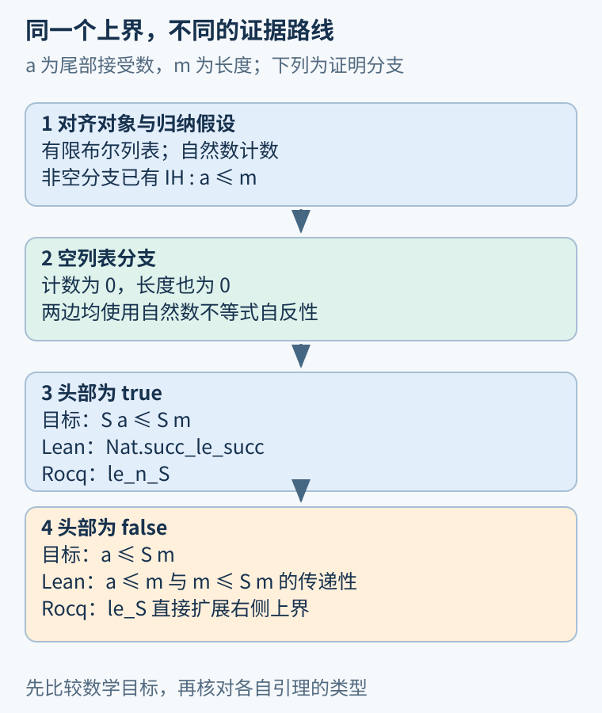
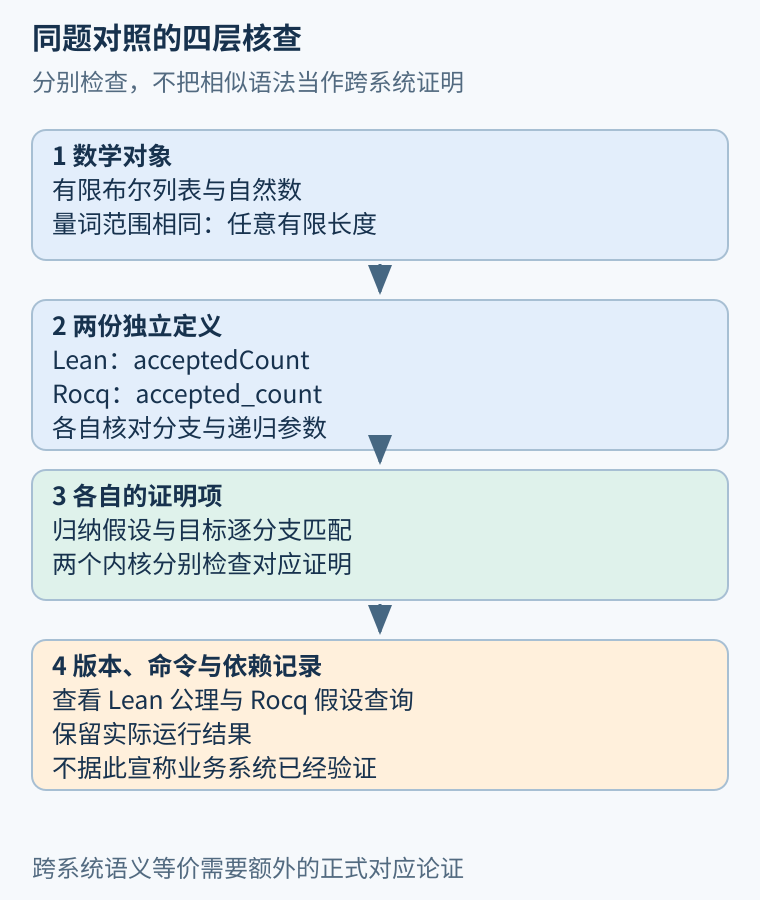

# 第 29 章 Lean 与 Rocq 同题对照：证据、目标与自动化

换一种证明语言，最值得比较的是同一个性质怎样被表达、递归定义如何影响证明、局部证据怎样进入目标。命令名字相似，并不让两个系统的证明文件可以互换。本章用“接受条目数不超过列表长度”连接两份真实源码。

## 先对齐数学对象

[Lean 实作](39.md)使用 `List Bool` 与 `Nat`，Rocq 文件使用 `list bool` 与 `nat`。在本例中，两边都研究有限布尔列表与自然数计数。数学结论可以写成：对任意列表 xs，接受条目数量不超过其长度。

但“数学上同题”不等于证明系统之间已建立形式等价。Lean 的 `acceptedCount` 与 Rocq 的 `accepted_count` 是各自环境里的定义，两个内核分别检查各自证明。若要正式宣称跨系统转换可靠，还需要验证对象、定义与证明翻译的对应，本书没有暗中完成这项工作。

| 意图 | Lean 随书写法 | Rocq 随书写法 |
| --- | --- | --- |
| 列表元素 | `[true, false, true]` | `[true; false; true]` |
| 自然数后继 | `Nat.succ n` | `S n` |
| 列表长度 | `xs.length` | `length xs` |
| 接受数 | `acceptedCount xs` | `accepted_count xs` |
| 证明完成 | 所有目标被构造成证明项 | 所有目标完成后以 `Qed` 保存 |

这张表是本例的读法，不是完整语法翻译器。库名、构造子、隐式参数和默认化简规则还会影响实际写法。

## Rocq 的上界证明怎样推进

完整结论在 [Foundations.v](../examples/rocq/Foundations.v) 中：

```coq
Theorem accepted_count_le_length :
  forall xs : list bool, accepted_count xs <= length xs.
Proof.
  induction xs as [|b rest IH].
  - exact (Nat.le_refl 0).
  - destruct b.
    + cbn [accepted_count length].
      exact (@le_n_S _ _ IH).
    + cbn [accepted_count length].
      exact (@le_S _ _ IH).
Qed.
```

`induction` 覆盖空表及非空表。在空表分支中，两侧按定义都是零，`Nat.le_refl 0` 提供自反性证据。非空分支获得 `IH: accepted_count rest <= length rest`，再按布尔头部分类。构造子的顺序决定这里先出现 true，再出现 false；它与另一个文件中的分支书写顺序不必相同。

true 分支展开后，目标是 `S (accepted_count rest) <= S (length rest)`。`le_n_S` 将尾部的不等式提升到两端各加一。false 分支则是 `accepted_count rest <= S (length rest)`；`le_S` 在保留左侧的同时扩大右侧上界。两条证据的类型恰好对应不同分支。代码中的 `@` 要求显式提供该常量原本可能隐式处理的参数；两个下划线仍让系统依据目标推断数值参数。



图 29-1：比较先对齐归纳假设与分支目标，再看具体引理。false 分支不要求机械复用同一种证明路线。

Lean 文件在 false 分支通过不等式传递性，先到尾部长度，再到其后继；Rocq 文件直接用不等式构造子扩展上界。二者支持同样的数学步骤，却不是逐行替换。理解这一点，才能判断迁移失败是缺少某个引理，还是误解了目标。

## 计算相等与已有定理重写

Rocq 的 `cbn` 根据指定定义执行计算化简；`reflexivity` 可以关闭两侧定义上可转换的等式目标。`rewrite IH` 则依据已有相等证明替换表达式。这三种操作容易在入门时混在一起。[Rocq 转换规则手册](https://rocq-prover.org/doc/V9.0.0/refman/language/core/conversion.html)给出定义展开与计算转换的基础。

例如，随书自然数计数函数每层加二。后继分支先将目标展示为：

```text
S (S (two_per_item k)) = S (k + S k)
```

归纳假设把左侧递归调用替换成 `k+k`，再用 `Nat.add_succ` 处理右侧，最后两侧相同。若不区分计算展开与定理重写，就很难说明每一步为何允许。

库定义的递归方向还会改变哪些式子能直接计算。读者不应从一个系统中“这个等式能用自反性”的经验，推断另一个系统也必然如此。可用 `Print` 查看定义，再用 `Check` 核对引理完整类型；选择证据应依据目标结构，而非名字猜测。

## 自动化帮助构造，结果仍需检查

Rocq 的 `apply` 依据结论匹配当前目标，并产生尚需证明的前提；`exact` 要求所给项直接符合目标；`destruct`、`induction` 使用数据类型对应的分类或归纳结构。[策略手册](https://rocq-prover.org/doc/V9.0.0/refman/proof-engine/tactics.html)解释了这些操作如何变换证明状态。

Lean 的相近操作也围绕证明项工作，但策略语言、简化集合及搜索机制不同。一个很短的自动化脚本，可能隐藏许多库引理；一个较长的显式脚本，可能更便于教学或限制依赖。不能只凭代码行数判定证明强弱或系统能力。

本例刻意使用明确的归纳、构造子与加法定理，便于逐步追踪证据。扩大到真实验证工程后，可以使用更强自动化，但应继续核对定理陈述、依赖与未完成目标。工具自动找到证明，不会替作者决定业务规格是否正确。



图 29-2：两边分别检查同题结论，可以增加理解与交叉发现错误的机会；不自动成为跨系统语义等价证明。

## 改坏实现，可能仍通过较弱性质

把 false 分支改成也加一，函数就统计全部条目。不超过列表长度仍可证明，接受条目含义却错了；若把 true 分支改成加二，单元素 `[true]` 已违反上界。前者暴露规格过弱，后者提供实现与规格冲突的具体反例。

两套系统都不能靠“证明很多”弥补错写的命题。若要完整描述接受计数，还需表达每个元素的贡献，或与过滤后长度建立联系。选择更完整性质时，也要注意新增定义是否只是把同一个错误重新复制了一遍。

## 同一条不等式有不同证据路线

false 分支中，设尾部计数为 a、长度为 m，已知 `a<=m`。一种路线是串联 `a<=m` 与 `m<=S m`，另一种路线是直接使用自然数不等式的后继构造。两者都把已知证据变成 `a<=S m`。比较时应先写出这个数学中间层，再寻找各自库中的引理，才能避免把某个库接口当成数学规律本身。

true 分支则不同：它需要的是 `S a<=S m`。仅扩大右侧并不足以得到左侧也增加后的结论。一个字母的区别会改变证据形状，这正是类型检查帮助暴露细节的地方。图中可以共用相同输入和目标，但不应假装所有步骤都有同名策略对应。

## 一份对照实验应怎样记录

首先固定两份文件与工具链版本，分别检查完整文件，而不是挑选几段成功的交互记录。其次核对两边到底量化了哪些输入：这里都是所有有限布尔列表，没有悄悄限制为某个最大长度。再核对数值域与失败语义：自然数计数没有机器回绕，函数也未调用可能抛异常的外部接口。

最后分别查看假设依赖。Rocq 使用 `Print Assumptions`，Lean 文件使用公理查询；没有额外公理依赖，仍然不等于没有逻辑基础、没有库定义或无需信任检查器。两个工具各自返回成功，也不能给未建模网络、持久化或并发行为提供证据。

这种克制的比较比排行榜更适合学习。读者可以问：在哪个定义上多做了一次展开，哪个分支需要显式引理，哪份错误信息更容易定位当前误解？这些差异会影响实际工作体验，但它们应从具体实验记录获得，而不是从单个小例子的脚本长度推断整个生态。

## 练习与参考答案

只有 `destruct xs`，没有归纳，非空分支是否自然获得尾部上界？再比较 `le_n_S` 与 `le_S`，它们各适合哪个布尔分支？

参考答案：仅分类不产生递归性质的归纳假设。true 分支两侧均取后继，使用 `le_n_S`；false 分支计数不变、右侧长度取后继，使用 `le_S`。如果交换它们，项的类型将无法直接匹配目标；这类失败反而帮助我们确认程序分支究竟改变了什么。

## 本章资料

- 随书源码：[Lean Foundations.lean](../examples/lean/Foundations.lean)、[Rocq Foundations.v](../examples/rocq/Foundations.v)。
- Rocq 9.0.0：[Conversion rules](https://rocq-prover.org/doc/V9.0.0/refman/language/core/conversion.html)、[Tactics](https://rocq-prover.org/doc/V9.0.0/refman/proof-engine/tactics.html)。
- Lean：[Induction and Recursion](https://lean-lang.org/theorem_proving_in_lean4/Induction-and-Recursion/)，结构归纳与证明项生成的对应读法。
