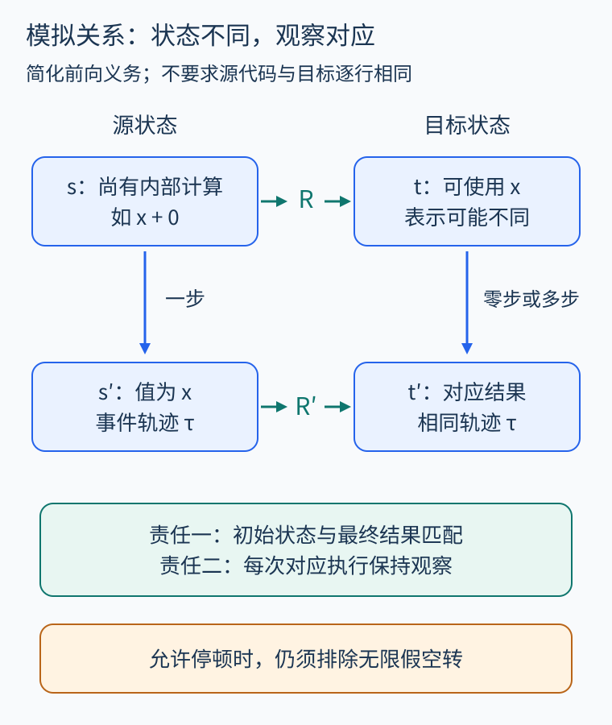
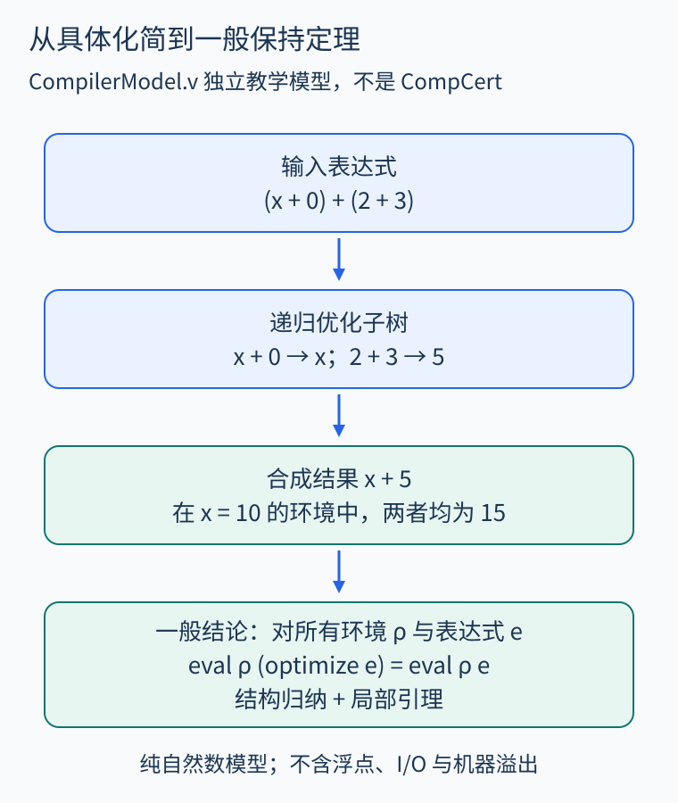
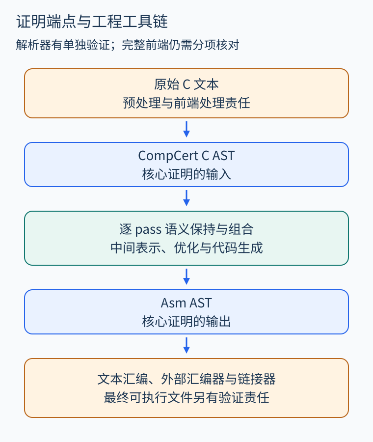

# 第 32 章 CompCert 案例：程序语义、模拟与编译正确性

源程序已经证明不越界，编译后的程序会不会因为编译器错误而越界？这是源码验证留下的一段缺口。CompCert 用 Rocq/Coq 中的语义定义与证明，连接源程序和生成代码。读这个案例，重点是看清它证明了什么，以及结论怎样跨过不同表示。

## 先读定理的输入与结论

在官方 [Compiler 源码文档](https://compcert.org/doc/html/compcert.driver.Compiler.html)中，`transf_c_program_correct` 的核心结构是：若 `transf_c_program p = OK tp`，则源程序语义与目标 Asm 语义之间存在指定的 `backward_simulation`。`OK` 是成功结果，不表示编译器必须接受所有输入；`p`、`tp` 是形式语言的语法树，不是磁盘上的 C 文件和可执行文件。

这也不是“编译器验证输入程序符合业务规格”。退款程序若原本重复付款，忠实编译仍会保留这个问题。源码验证负责证明所需性质，编译正确性负责跨表示传递适用的保证。此前的[程序等价、精化与编译变换验证](41.md)提供了理解这一区别的框架。

## 观察什么，才能比较两个程序

寄存器名字、临时变量和内部步数可以改变，因此不能要求源状态等于目标状态。官方 [Behaviors 模块](https://compcert.org/doc/html/compcert.common.Behaviors.html)用外部事件轨迹以及终止、静默发散、持续交互和出错等结果描述行为。比如，两份退款实现都向建模的外部接口提交同样事件并正常退出，内部一个用了临时变量，另一个直接计算，不一定构成行为差异。

但这仍取决于观察模型。执行时间、缓存轨迹和内存消耗并不自动包含在这种行为等价里；不能据此证明恒定时间、性能上界或物理侧信道安全。外部付款接口的真实含义，也需要与所用外部函数模型对应。

## 模拟关系怎样跨过一次优化

设源程序计算 `x+0`，目标直接取 `x`。教学上可以把关系写成“源表达式在环境 ρ 下的值，等于目标保存的值”。源端还会执行一次加法，目标端可能已经到达相应结果；证明需要允许两边走不同数量的内部步。



图 32-1　模拟不是逐行相同：匹配状态可以具有不同表示和不同内部进度。此图展示简化的前向匹配义务，不替代真实模拟定义。

官方 [Smallstep 模块](https://compcert.org/doc/html/compcert.common.Smallstep.html)把匹配初始状态、对应执行、最终结果等要求组织起来。允许目标少走内部步时，还要排除无限空转的假证明：否则可以把源程序无限执行都说成目标“不需要移动”，错误地丢失发散行为。良基递减条件是控制这类停顿的一种办法。

前向模拟便于逐步对应某次源执行，却不能不加条件就推出“目标没有额外行为”。CompCert 的整体证明还组合策略语义、确定性与相应模拟定理，最终建立适合约束目标行为的关系。官方 [Compiler](https://compcert.org/doc/html/compcert.driver.Compiler.html)展示了逐 pass 组合的实际结构，不能把本章的小图当成全部证明。

## 未定义行为为什么改变结论

官方[语义保持说明](https://compcert.org/man/manual001.html)使用“目标行为改进某个允许的源行为”的表述。这里的改进是技术关系，不表示更快：源执行若在某段轨迹后出错，目标可以具有延续该轨迹前缀的、更有定义的行为。[Behaviors](https://compcert.org/doc/html/compcert.common.Behaviors.html)中的 `behavior_improves` 给出了精确关系。

因此，不能要求编译器忠实重现一次除零崩溃，也不能把源程序未定义行为当作可靠业务输出。若源程序在适用模型下没有这类出错行为，目标就须符合允许的源行为。还要区别源语言原本允许的多种行为：编译器可以确定其中一种，不必保留全部选择。

## 亲手检查一个极小的优化

本书的 [CompilerModel.v](../examples/rocq/CompilerModel.v)独立定义自然数表达式，仅含常量、变量与加法；环境 `rho : nat -> nat` 给变量编号赋值。`eval` 递归求值；`smart_add` 折叠两个常量，或删除右侧的字面常量零；`optimize` 先递归优化子表达式，再使用它。

```rocq
Theorem optimize_correct : forall rho e,
  eval rho (optimize e) = eval rho e.
```

示例输入是 `(x+0)+(2+3)`。先把左子树化为 `x`，右子树折叠为 5，再得到 `x+5`。当环境给 `x` 赋值 10 时，两者都是 15；定理的全称量词则要求所有环境、所有表达式都成立，超出了这一个输入的计算。



图 32-2　具体计算帮助理解变换，结构归纳负责覆盖任意表达式；两者不是同一层证据。

证明先建立 `eval_smart_add`，检查智能构造函数的各个分支，再对表达式结构归纳。在加法情形，两个归纳假设分别保证子树优化不改值，局部引理保证合成不改值。代码还把结果写成 `optimize_observations`：观察到自然数结果 `n`，在优化前后等价。

阅读证明目标时，可以暂停在加法分支：左边是两个优化子树经 `smart_add` 合成后的求值，右边是原有两个子树的结果之和。先用局部引理把左边展开为优化子树的求值之和，再用两个归纳假设替换，目标便成为相同表达式的自反等式。这里没有假设“优化必然正确”，而是把大树的责任拆给严格更小的子树与可逐项检查的局部变换。

这个模型没有机器溢出、浮点、堆、I/O、异常和不终止。删除零常量不产生副作用；若把规则泛化成“删除任意求值为零的调用”，就必须重新处理调用的效果与终止。该文件仅依赖 Stdlib，并以 `Print Assumptions` 检查定理依赖；复现命令和实际检查记录见[示例目录](../examples/rocq/README.md)。它不导入 CompCert，也不构成对 CompCert 本身的重新验证。

## 工程链条上还有哪些责任

官方手册把核心结论的端点界定为 CompCert C AST 与 Asm AST。预处理、完整前端处理、文本输出、外部汇编器与链接器，不能仅凭这一定理一并视为已验证；其中解析器有单独的验证，不能反过来说整个前端毫无证明。具体责任需按采用版本与配置核对。



图 32-3　绿色范围表示本章讨论的核心 AST 到 AST 证明。外部步骤需要其他保证，颜色不评价其实现质量。

还要区分“形式化链接”和“调用系统链接器”：官方的分别编译定理在给定形式链接条件下连接编译单元，并未因此验证任意系统链接器、运行库和混合工具链。实际部署还依赖语义模型与平台相符、证明检查机制，以及从形式函数提取为 OCaml、再编译成可执行编译器的链条。[官方构建说明](https://compcert.org/man/manual002.html)还指出该过程会结合手写 OCaml 支持代码；这些责任不能因数学函数已有证明而省略。硬件故障、错误接口模型和业务规格遗漏，都不是语义保持定理自动排除的风险。

这条思路也连接程序分析。官方 [Constpropproof](https://compcert.org/doc/html/compcert.backend.Constpropproof.html)把值分析与变换证明连接起来；[Allocproof](https://compcert.org/doc/html/compcert.backend.Allocproof.html)展示了寄存器分配的验证式翻译。复杂启发式可以提出候选，但被采用的结果仍须经过有正确性依据的检查。理解这一区别，有助于设计带验证边界的现代分析与优化系统。

## 练习

微型模型已证明优化保持求值，能否立即把结论用于 C 浮点表达式和读取设备寄存器的表达式？

参考答案：不能。模型只含纯自然数运算。浮点需要对应舍入与特殊值语义，设备读取需要事件及副作用模型；先修改语义和变换前提，再重新证明。更换模型后，原定理不会自动扩大适用范围。

## 本章资料

- [CompCert 手册：语义保持与结构](https://compcert.org/man/manual001.html)。
- [Compiler](https://compcert.org/doc/html/compcert.driver.Compiler.html)、[Behaviors](https://compcert.org/doc/html/compcert.common.Behaviors.html)、[Smallstep](https://compcert.org/doc/html/compcert.common.Smallstep.html)：真实定理与关系定义。
- [Constpropproof](https://compcert.org/doc/html/compcert.backend.Constpropproof.html)、[Allocproof](https://compcert.org/doc/html/compcert.backend.Allocproof.html)：分析与验证式翻译的实例。
