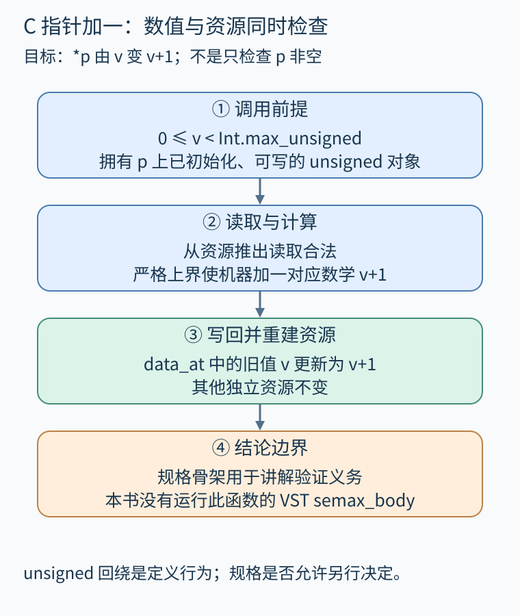
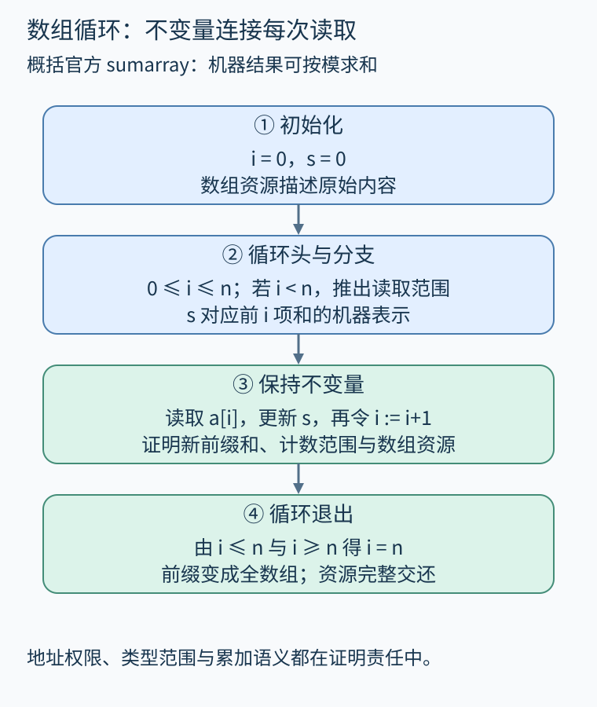
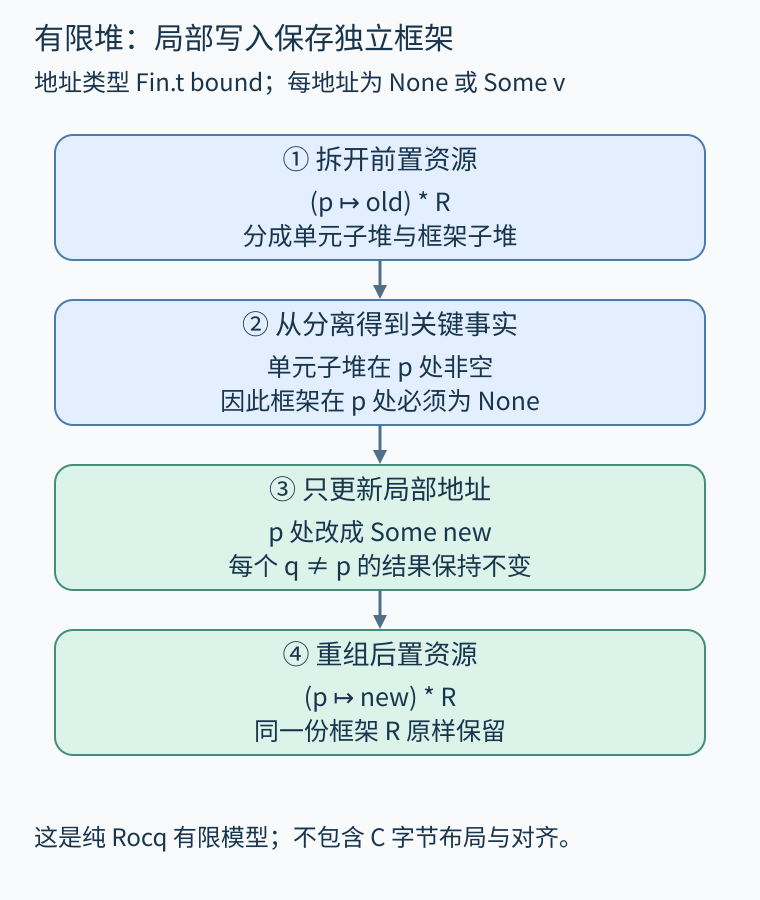

# 第 33 章 VST 案例：C 程序、内存资源与验证责任

证明数学函数返回正确金额，与证明C程序真的从有效地址读写，是两层任务。C代码还涉及机器整数、指针、内存权限和函数调用约定。VST（Verified Software Toolchain）把函数规格、分离逻辑与Clight程序语义连接起来，使“这次写入为什么合法”成为可以展开检查的证明义务。

本章区分两项成果：先阅读真实VST案例的规格和证明结构；再用纯Rocq标准库建立一个有限地址堆，机械检查读写与框架保存。后者没有导入VST，也不是实际C函数的 `semax_body` 证明；本次没有编译整套VST工程。

## 一次指针加一需要哪些保证

先看本书构造的小函数：

```c
void bump(unsigned *p) {
    *p = *p + 1U;
}
```

预期性质是：p指向的无符号整数由v变为数学上的v+1，其他独立资源不变。只有 `p!=NULL` 远远不够：地址可能已释放、对齐不合要求、没有写权限，或者根本不指向一个完整的unsigned对象。

在以32位unsigned为目标的Clight/VST模型里，可以要求 `0≤v<Int.max_unsigned`，并拥有该地址上已初始化对象的可写资源。下列是解释用规格骨架，依赖相应AST生成的标识符与VST环境，未作为本书独立编译文件：

```text
DECLARE _bump
WITH p : val, v : Z
PRE [ tptr tuint ]
  PROP (0 <= v < Int.max_unsigned)
  PARAMS (p)
  SEP (data_at Tsh tuint (Vint (Int.repr v)) p)
POST [ tvoid ]
  PROP () RETURN ()
  SEP (data_at Tsh tuint (Vint (Int.repr (v+1))) p)
```

PROP放数学范围，PARAMS把C参数与逻辑值p联系起来，SEP描述内存资源。这里选择Tsh表示完整份额，避免把只读权限误当作写权限。`data_at` 不只是说“地址上恰好有这个数”，还包含对应类型对象的资源要求。[VST官方数组教程](https://softwarefoundations.cis.upenn.edu/vc-current/Verif_sumarray.html)给出了这些规格组成部分的实际用法。

unsigned加法到最大值时按机器语义回绕，不是C有符号溢出的同一种情况。我们给出严格上界，是为了让机器结果对应未回绕的数学v+1；如果规格本就要求模运算，可以选择另一条后置条件。证明哪个版本，取决于规格而不是函数名字。



图 33-1　数值责任与内存责任同时存在；完整资源不能由一个非空指针判断替代。原创精确示意。

## 从C文本走到真实证明目标

[Clight官方定义](https://compcert.org/doc/html/compcert.cfrontend.Clight.html)把表达式设计为纯表达式，赋值与调用由语句表示。这样，C表面写法经过前端整理后，证明可以逐步处理读、算、写。具体AST和目标平台必须与生成它们的工具版本匹配，不能把伪代码当作已经解析的Clight函数体。

真实VST源码中的目标具有 `semax_body Vprog Gprog f_sumarray sumarray_spec` 这样的结构：它把全局变量规格、被调用函数规格、实际函数体和目标规格放在同一个判断里。[VST的verif_sumarray.v](https://github.com/PrincetonUniversity/VST/blob/master/progs/verif_sumarray.v)随后使用 `start_function`、`forward`、`forward_while` 推进证明。策略帮助应用逻辑规则，留下的范围、资源和蕴含目标仍必须成立。

在bump里，第一次解引用要证明可读，写回时要证明可写；计算结果要与规格中的Z整数对应；返回时要把更新后的对象资源交还。若函数调用其他函数，调用点还须满足对方的前置条件，不能因为对方已有定理就忽略自己的责任。

## 循环不变量不只记录一个和

官方sumarray案例遍历unsigned数组并返回累加值。把其关键不变量用便于阅读的形式写成：`0≤i≤n`，s对应前i项数学和的机器表示，整个数组仍以原内容被拥有。

进入循环时i=0、s=0；在 `i<n` 分支，需推出i处于数组范围，才能读取a[i]；更新后要把前缀和从i项扩成i+1项；退出时由i≥n和i≤n得到i=n。计数器是有符号int，因此n的范围还要足以支持i递增。数组未被修改这一事实，则通过资源断言贯穿循环。

这里累加结果使用机器表示 `Int.repr`：总和可能超出unsigned范围，规格可以仍然正确描述模结果，不能误读为没有回绕的数学求和。[链表反转教程](https://softwarefoundations.cis.upenn.edu/vc-current/Verif_reverse.html)又展示了两个链表片段的分离资源如何随循环重组；节点连接关系变化时，仅保存长度或元素总和显然不足以说明内存仍合法。



图 33-2　每轮同时维护纯事实、局部值和空间资源；退出条件把前缀性质连接到完整结果。原创精确示意。

## 有限堆练习：写一个单元，为何保留其余资源

[HeapModel.v](../examples/rocq/HeapModel.v)使用 `Fin.t bound` 作为地址类型：固定bound后地址集合有限。堆是这些地址到 `option Z` 的映射，None表示没有单元，Some v表示拥有该单元。堆相等按逐地址结果定义，不依赖函数外延性公理。

`points p v` 表示只拥有p处的一个单元。分离组合P*R要求存在两个不相交子堆，它们的合并与当前堆逐地址相同，并分别满足P和R。这样同一个独占单元不能被复制成两份资源，两个指针名字相同或不同都不会改变这一规则。

文件证明的框架结论为：

```text
(points p old * R)(h)
    ⇒ (points p new * R)(write h p new)
```

关键步骤是从分离前提推出框架子堆在p处为空；新单元仍只占p，因此与原框架继续分离；对任意q≠p，写入结果与原堆相同，所以R使用的那份堆原封不动地保留。这里R可以是任意堆谓词，证明没有逐一枚举它可能描述的其他对象。

数学write是总更新函数，本身允许给空位置赋值；定理的前置条件明确要求p已被拥有，因此该结论讨论已有单元更新，不是在证明C分配。模型也没有字节布局、对齐、释放、共享只读份额或并发语义。它解释局部资源推理的骨架，不能替代VST的实际内存模型。



图 33-3　先证明框架不占p，再更新局部单元，最后重组资源。原创精确示意。

## 别名条件怎样进入调用点

若调用者还保存指针q，并且q也指向p处单元，写入后通过q读取自然会看到新值；不能把“变量名不同”作为资源独立的证据。框架描述的是未被本次操作占用的内存部分，不是所有没有出现在函数参数表里的变量。

如果把例子扩展为处理结构体的函数，使它沿指针字段继续写入另一个对象，局部足迹随之扩大，原来只拥有一个单元的前提就不够。需要把新访问对象加入规格，或利用被调用操作的契约。局部推理能减少重复证明，前提是每次访问都已在资源模型中得到解释；它不是忽略任意隐藏副作用的许可。

## 证明的交付边界

本书对有限堆文件的实际检查状态、工具链和 `Print Assumptions` 输出记录在统一报告中。读者应区分“Rocq检查了这个有限模型”“VST证明了某个Clight函数体”和“目标可执行文件满足规格”这三种结论。将它们连接起来还需源文件身份、前端、编译语义保持、外部库与运行环境的适用条件，可参照[CompCert案例](54.md)。

## 练习与答案

把前提改成 `(p↦3)*(p↦9)`，能否让一次写入同时更新两份独立资源？如果两个调用者都持有只读权限，情况又如何？

**参考答案：**本章独占模型中这个前提无法满足：分离要求至少一份子堆在p处为空，但两份都占有p。VST更丰富的份额体系可以描述受约束的共享读取；这仍不等于任一读者可单独写入。读、写权限与资源组合规则必须一起检查，不能靠复制指针获得权限。

## 本章资料

- [Software Foundations：Verif_sumarray](https://softwarefoundations.cis.upenn.edu/vc-current/Verif_sumarray.html)。真实VST规格与数组循环验证。
- [VST：progs/verif_sumarray.v](https://github.com/PrincetonUniversity/VST/blob/master/progs/verif_sumarray.v)。函数体证明与循环义务源码。
- [Software Foundations：Verif_reverse](https://softwarefoundations.cis.upenn.edu/vc-current/Verif_reverse.html)。链表资源拆分与重组。
- [CompCert：Clight](https://compcert.org/doc/html/compcert.cfrontend.Clight.html)。语法、类型与操作语义定义。
